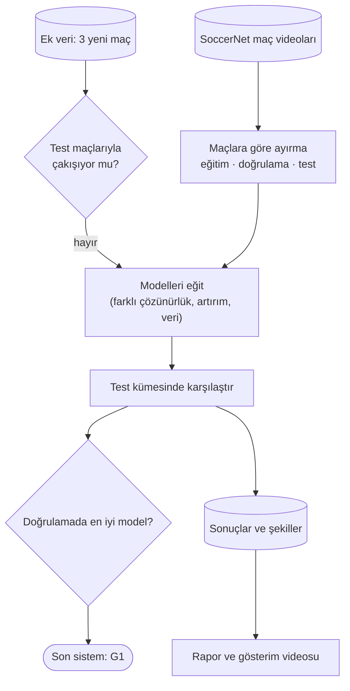

# Deney akışı

| Model | Fark | Test top AP@0.5 |
|---|---|---|
| E1 | Hazır model, eğitimsiz | 0,202 |
| E2 | 640 px | 0,158 |
| E3 | 1280 px + top kopyala-yapıştır | 0,309 |
| A1 | 1280 px | 0,353 |
| **G1** | **1280 px + 3 maç ek veri (son sistem)** | **0,391** |
