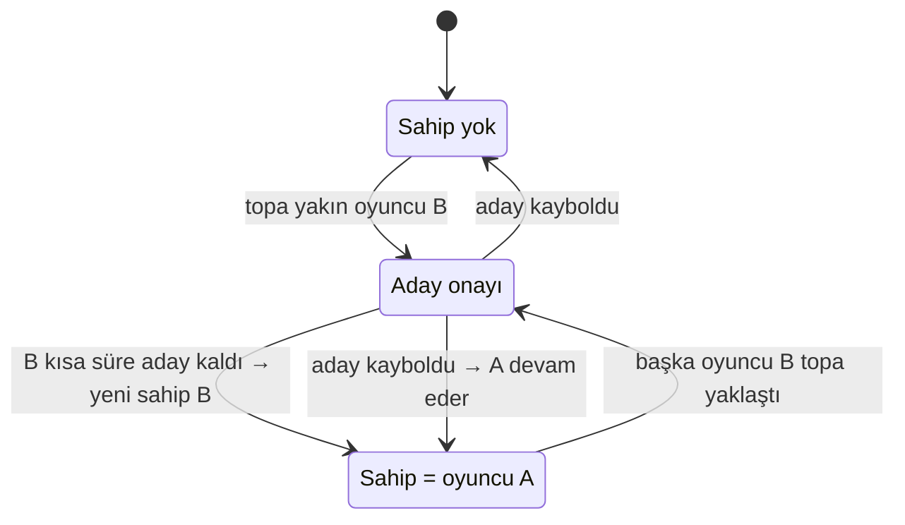
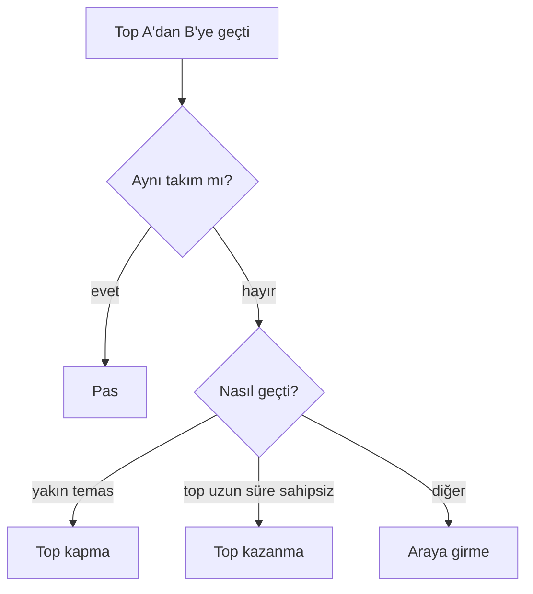

# Top sahipliği ve olaylar

## Sahiplik

Topa en yakın oyuncu hemen sahip sayılmaz; kısa bir süre aday kalması gerekir. Böylece topun
yanından geçen oyuncu sahipliği değiştirmez.

## Top el değiştirince

